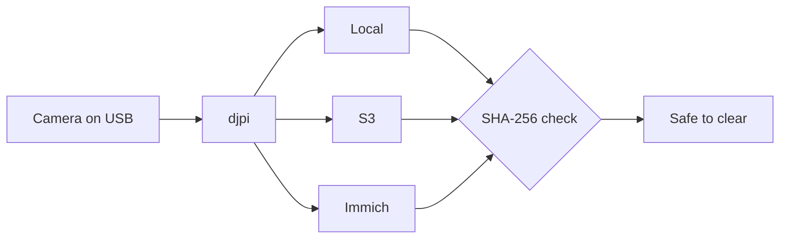

# djpi

Plug in a DJI camera and walk away. djpi copies every file from a DJI Osmo
Action 6 or Pocket 3 to your archives (local, S3, Immich), checks each copy byte
for byte, and tells you when the card is safe to clear. It never deletes anything.



Tested on real cameras: 293 files (8.43 GB) from an Action 6 to S3, every one
re-read and verified, and a restart picked up where it left off without
re-uploading anything.

## Run

```console
go run ./cmd/djpi serve --config djpi.example.json
go run ./cmd/djpi audit --config djpi.example.json   # re-verify everything
nix develop --command ./scripts/check.sh             # tests + lint
```

More: [usage](docs/usage.md) · [config](docs/configuration.md) ·
[NixOS](docs/deployment-nixos.md) · [roadmap](docs/PROJECT.md)

Pre-1.0. Wired ingest works; wireless and Bluetooth control are in progress.
